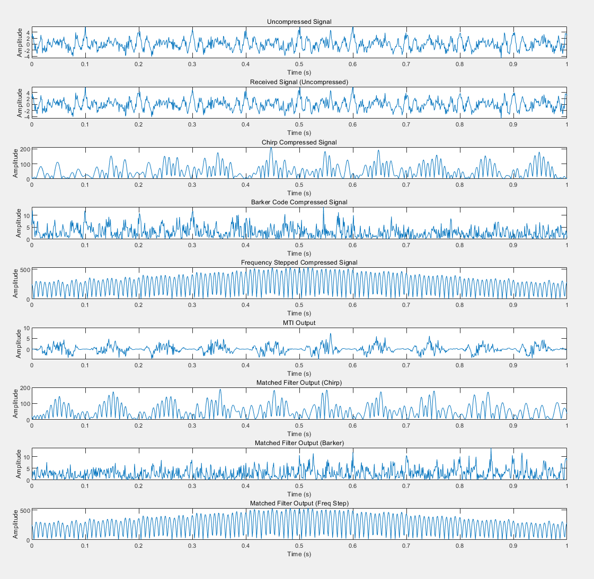

# [Free]Linear Frequency Modulation Pulse in Noise, Buck code, Frequency stepping pulse radarMTI, Pulse compression[AttachedMATLABCode]

MATLABMain code% Generate radar signals\nFs = 1000; % Sampling frequency\nT = 1/Fs; % Sampling interval\nt = 0:T:1; % 1 second\nnum_samples = length(t);\n​\n% Generate three airplane signals\n​\n% Generates ground clutter and bird signals\n​\n% Uncompressed signal\n\n​\n% Synthesize the overall signal\n\n​\n% Chirp pulse compression\n\n​\n% Buck code pulse compression\n\n​\n% Frequency Step-up Pulse Compression\n\n​\n% MTI cancellation\n\n​\n% Matching filter\n\n​\n​\n% Matching filter\n\n​\n​\n% Display results\nfigure;\nsubplot(9, 1, 1);\nplot(t, received_signal);\ntitle('Uncompressed Signal');\nxlabel('Time (s)');\nylabel('Amplitude');\n​\nsubplot(9, 1, 2);\nplot(t, uncompressed_signal);\ntitle('Received Signal (Uncompressed)');\nxlabel('Time (s)');\nylabel('Amplitude');\n​\nsubplot(9, 1, 3);\nplot(t, chirp_compressed_signal);\ntitle('Chirp Compressed Signal');\nxlabel('Time (s)');\nylabel('Amplitude');\n​\nsubplot(9, 1, 4);\nplot(t, barker_compressed_signal);\ntitle('Barker Code Compressed Signal');\nxlabel('Time (s)');\nylabel('Amplitude');\n​\nsubplot(9, 1, 5);\nplot(t, freq_step_compressed_signal);\ntitle('Frequency Stepped Compressed Signal');\nxlabel('Time (s)');\nylabel('Amplitude');\n​\nsubplot(9, 1, 6);\nplot(t, output_signal_mti);\ntitle('MTI Output');\nxlabel('Time (s)');\nylabel('Amplitude');\n​\nsubplot(9, 1, 7);\nplot(t, matched_filter_output_chirp);\ntitle('Matched Filter Output (Chirp)');\nxlabel('Time (s)');\nylabel('Amplitude');\n​\nsubplot(9, 1, 8);\nplot(t, matched_filter_output_barker);\ntitle('Matched Filter Output (Barker)');\nxlabel('Time (s)');\nylabel('Amplitude');\n​\nsubplot(9, 1, 9);\nplot(t, matched_filter_output_freq_step);\ntitle('Matched Filter Output (Freq Step)');\nxlabel('Time (s)');\nylabel('Amplitude');\nMATLABSimulation results\n        \n  
​  

## Images

<!-- PAYMENT_BLOCK -->

## Get this dataset

- Payment link (Stripe): [Buy now](https://buy.stripe.com/3cs8yP7sY87d0vu9AB)
- Payment QR code: 

<!-- /PAYMENT_BLOCK -->
